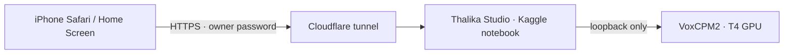

# Thalika — iPhone + Kaggle GPU Edition

မြန်မာစာမှ သင့်အသံဖြင့် WAV ထုတ်နိုင်သော private voice studio ဖြစ်ပါသည်။ **iPhone Safari** မှ သုံးပြီး
AI model ကို **Kaggle notebook ၏ အခမဲ့ T4 GPU** ပေါ်တွင် run ပါသည်။ မူရင်း **VoxCPM2 2.0.3** engine၊
Burmese normalization၊ pronunciation lexicon၊ stable seed၊ chunk quality checks နှင့်
**48 kHz mono 24-bit PCM WAV** pipeline ကို ဆက်လက်အသုံးပြုထားပါသည်။

မူရင်း: [San Lin Htike / Thalika](https://github.com/sanlinhtik3/thalika-voice-clone) · [Apache-2.0](LICENSE) · [NOTICE](NOTICE)။
မူရင်းရေးသားသူနှင့် မသက်ဆိုင်သော ပြင်ဆင်ထားသည့် edition ဖြစ်ပါသည်။ Model weights နှင့် dependencies များ၏
သီးခြား license စည်းကမ်းများကိုလည်း လိုက်နာပါ။



## စတင်ရန် (တစ်ကြိမ်တည်း)

1. [kaggle.com](https://www.kaggle.com) account တွင် **ဖုန်းနံပါတ် verify** လုပ်ပါ (GPU နှင့် Internet အတွက်လိုသည်)။
2. **Create → New Notebook → File → Import Notebook** ဖြင့် [`kaggle/thalika-kaggle.ipynb`](kaggle/thalika-kaggle.ipynb) ကိုထည့်ပါ။
3. Notebook **Settings**: **Accelerator → GPU T4 x2**၊ **Internet → On**၊ notebook ကို **Private** ထားပါ။
4. **Add-ons → Secrets**: `THALIKA_OWNER_PASSWORD` (စာလုံး ၁၂ လုံးအထက်) ထည့်ပြီး ဒီ notebook ကို attach လုပ်ပါ။

အသေးစိတ်၊ optional secrets နှင့် ပြဿနာဖြေရှင်းနည်း: **[Kaggle လမ်းညွှန်](docs/KAGGLE.my.md)**။

## နေ့စဉ် အသုံးပြုပုံ

1. Kaggle notebook တွင် **Save Version → Save & Run All (Commit)** ကိုနှိပ်ပါ။ iPhone ပိတ်ထားလည်း ~၁၁ နာရီ run နေမည်။
2. Version log ထဲတွင် `iPhone Safari: https://….trycloudflare.com` ပေါ်လာသည်အထိစောင့်ပါ (ပထမ ၁၀–၂၀ မိနစ်)။
3. ထို link ကို **Safari** ဖြင့်ဖွင့်ပြီး owner password ဖြင့်ဝင်ပါ။ **Settings** တွင်
   **Loading VoxCPM2 → Warming Up Model → Ready** ဖြစ်မှ စသုံးပါ။
4. **Voices** တွင် **Files / Browse / iCloud Drive** မှ WAV သို့မဟုတ် M4A reference clip ရွေးပါ။
   6–30 seconds၊ တစ်ယောက်တည်းပြောသော၊ music မပါသည့်အသံကို အကြံပြုသည် (အများဆုံး 10 MiB / 50 seconds)။
5. သင့်အသံဖြစ်ကြောင်း သို့မဟုတ် အသံပိုင်ရှင်၏ ခွင့်ပြုချက်ရကြောင်း အတည်ပြုပါ။ AI output သည် မူရင်းလူ၏အသံနှင့်
   တစ်ထပ်တည်းဖြစ်မည်ဟု အာမမခံပါ။
6. **Studio** တွင် မြန်မာစာထည့်ပါ။ Pronunciation preview ကိုဖတ်ပြီး approve လုပ်ပါ။ လိုအပ်ပါက lexicon ပြင်ပါ။
7. **Generate Local Audio** နှိပ်ပါ (“Local” = Kaggle GPU ပေါ်ရှိ VoxCPM2)။ Safari ပိတ်လည်း job ဆက်လုပ်သည်။
   **History** တွင် progress/results ပြန်ကြည့်နိုင်သည်။
8. Preview၊ **Download WAV** သို့မဟုတ် **Share / Save to Files** ဖြင့် iPhone ထဲသိမ်းပါ။
   **Kaggle session ပြီးလျှင် link အလုပ်မလုပ်တော့ပါ** — အရေးကြီး WAV များကို အရင် download လုပ်ပါ။

Bottom tabs: **Studio · Scripts · History · Voices · Settings**။ Scripts တွင် Gemini rewrite နှင့် revision များ၊
Settings တွင် GPU အခြေအနေ၊ Kaggle session ပြီးမည့်အချိန်နှင့် Storage ပါသည်။

## Data သိမ်းခြင်း

Voices၊ scripts၊ history နှင့် WAV များသည် `/kaggle/working/thalika-data` တွင်ရှိပြီး commit run ပြီးဆုံးလျှင်
Kaggle က version output အဖြစ်သိမ်းသည်။ နောက် session မတိုင်မီ **Add Input → Your Work → ဒီ notebook**
ကို attach လုပ်လျှင် နောက်ဆုံး data ကို အလိုအလျောက် restore လုပ်ပေးသည်။ Kaggle အပြင်ဘက်တွင်လည်း
version **Output** tab မှ download ပြီး encrypted backup ထားပါ ([Operations](docs/OPERATIONS.my.md))။

## iPhone Home Screen

Safari → Share → **Add to Home Screen**။ Quick-tunnel URL သည် session တိုင်းပြောင်းသဖြင့် shortcut ပြန်လုပ်ရမည်။
မပြောင်းသော URL လိုလျှင် [Kaggle လမ်းညွှန်](docs/KAGGLE.my.md) ရှိ Cloudflare named tunnel ကိုသုံးပါ။
Offline တွင် public notice သာပြသည်။ Private scripts/audio ကို service worker cache မလုပ်ပါ။

## ကိုယ့်ကွန်ပျူတာပေါ်တွင် development

Node.js **22.22.0**၊ Python **3.11**:

```bash
npm ci --ignore-scripts
npm run setup:owner          # .env.local နှင့် one-time password file (mode 0600)
npm run dev
bash scripts/voxcpm-local.sh # သီးခြား terminal: local GPU/CPU inference
```

`http://localhost:3000` တွင်ဝင်ပါ။ `npm run desktop` ဖြင့် Electron shell လည်းသုံးနိုင်သည်။
Real credential ပါသော file မည်သည့်အရာကိုမျှ Git ထဲမတင်ပါနှင့်။

စစ်ဆေးရန်: `npm run lint && npm test && npm run build && npm run test:e2e`။

[Architecture](docs/ARCHITECTURE.md) · [Operations](docs/OPERATIONS.my.md) · [Testing](docs/TESTING.md) ·
[Security](docs/SECURITY.md) · [Upstream audit](docs/AUDIT.md) · [Original README](docs/UPSTREAM_README.md)
