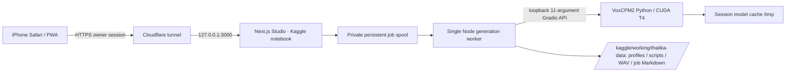

# Architecture

## Kaggle host

`scripts/kaggle-start.py` is the only deployment path. It needs no cloud-provider API key.
From a Kaggle notebook it:

1. Requires an NVIDIA GPU with compute capability ≥ 7.5 (T4). The pinned PyTorch 2.8
   CUDA 12.8 wheels do not support P100.
2. Reads owner secrets from Kaggle Secrets, derives the scrypt owner hash in the same
   format as `scripts/setup-owner.mjs`, and generates a fresh per-session `RUNTIME_TOKEN`.
3. Installs checksum-pinned Node 22.22.0 and cloudflared, and a Python 3.11 venv
   (via `uv`) from `local-server/requirements.lock`. It then runs `tests/python-contract.py`
   to check the real dependencies and the 11-argument Gradio contract with a test-double model.
4. Builds the Next.js standalone app.
5. Restores the newest `thalika-data` folder from attached inputs, chosen by its
   `.thalika-saved-at` marker.
6. Starts a Cloudflare tunnel to Node only, then `scripts/supervise.py`, which runs
   VoxCPM2 and Node as sibling processes with the data-directory lock.
7. At the session deadline (default 11 h, capped at 11.5 h because of Kaggle's 12 h limit),
   reserves a safe stop through `/api/internal/runtime`, waits for active generation,
   stops, and writes the saved marker so Kaggle keeps the data as notebook output.

Pre-Ampere CUDA (sm < 8.0, e.g. T4) loads float32 without `torch.compile`. bf16 is not
native there and Triton rejects bf16 compile. Newer GPUs keep the checkpoint dtype.
`VOXCPM_DTYPE` / `VOXCPM_OPTIMIZE` override this. Engine takes are written as PCM_24
into a private temp directory and pruned after Gradio copies them.

## Readiness

Python loads the model and completes warmup before opening Gradio; a failed cloud warmup
exits and the supervisor stops the sibling. Only a successful local Gradio contract probe
reports Ready. `/api/health` only means Node is alive. `/api/gpu/status` (owner session)
shows stage, active jobs and the Kaggle session deadline.

## Job semantics

Accepted generation validates original Zod / Burmese approval gates, checks real
model health, saves the script and job Markdown, and atomically persists the
private execution context. A UUID Idempotency-Key binds to a request digest.
A duplicate returns the previous job; a different payload with that key fails.
Generation is serialized in Node and Python. Polling reads durable job status.
Browser closure has no effect on the server worker.

Pending spool entries resume after Node starts. A running entry or orphan active
Markdown at startup is marked failed, never automatically replayed. Explicitly
retry after checking History; partial chunks are temporary and are regenerated.
Cancellation is cooperative at chunk/progress boundaries, not a CUDA preemption.
A selected History deletion removes private input content and the cancel marker,
retaining only a digest/ID tombstone so a stale replay cannot regenerate deleted work.

The safe-stop reservation blocks new submissions under the submission mutex and
refuses while pending/active jobs exist. A Kaggle "Cancel run" or quota exhaustion
is a hard stop that cannot be prevented; an in-flight job is then marked failed on
the next start.

## Storage

Data: `/kaggle/working/thalika-data` (saved as notebook output only by a completed
commit run). Config (Gemini settings) and model caches live under `/tmp/thalika-kaggle`
and are never written into notebook output. Run one Node process per data directory.
`DATA_QUOTA_GB` covers user data and spool, with a 512 MiB free-space reserve.
The app reports and reviews cleanup; it never deletes data automatically.

## Security boundaries

Owner password is salted scrypt; 12-hour HttpOnly SameSite=Strict HMAC sessions with
Secure cookies. The central Next proxy protects API and page routes, validates mutation
Origin against `APP_ORIGIN` (the tunnel URL), rate limits mutations and login, and
streams a 15 MiB body cap (including chunked requests). Audio payload has an independent
10 MiB decoded limit and signature validation. The internal endpoint uses a 32+ character
per-session bearer token and is used only by the launcher on loopback.

Node binds 127.0.0.1; Gradio binds 127.0.0.1:7860 and is never tunnelled. Shell/model
process mutations are blocked in cloud mode. Managed path joins reject traversal, and
storage traversal skips symlinks. The service worker caches only a public offline notice.
TLS terminates at Cloudflare. Kaggle and Cloudflare remain inside the trust boundary;
keep the notebook private because its output contains voice references and WAVs.
