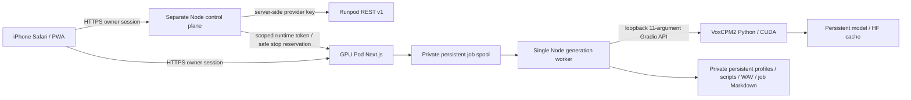

# Architecture

## Independent lifetimes

The control target is an independent lightweight CPU image, on an existing
always-on host with durable disk and HTTPS. It must never be hosted exclusively
inside the GPU Pod. It stores `control.json`, intent, tracked Pod ID, replay keys,
startup observation timestamps and last error in its private config directory.
The GPU target stores all user data and model caches on a network volume.
Runpod's provider dashboard is the no-additional-control-host fallback.
No infrastructure is created by app startup or GitHub push.

`ALLOW_GPU_PROVISIONING=0` is the default. Owner must explicitly opt in after
reviewing costs. Each create persists intent before the non-idempotent provider
POST. A timeout or lost response blocks another create until reconciliation.
A deterministic installation name plus Pod ID discovers existing resources.
A filesystem exclusive lock prevents concurrent controller mutations. A stale
lock after a crash is deliberately manual-recovery, never automatically cleared.

The provider request's desiredStatus is not model readiness. Only the private
runtime endpoint plus successful local Gradio contract probe enables Ready.
Python loads the model and completes warmup before opening Gradio. Failed cloud
warmup exits the process. The supervisor stops the sibling process if one dies.
The HTTP health check only means Node is alive; it never asserts inference ready.

## Job semantics

Accepted generation validates original Zod / Burmese approval gates, checks real
model health, saves the script and job Markdown, and atomically persists the
private execution context. A UUID Idempotency-Key binds to a request digest.
A duplicate returns the previous job; a different payload with that key fails.
Generation is serialized in Node and Python. Polling reads durable job status.
Browser closure has no effect on the server worker.

Pending spool entries resume after Node starts. A running entry or orphan active
Markdown at startup is marked failed, never automatically replayed. Explicitly
retry after checking History; partial chunks are temporary and are regenerated.
This is not a promise of exactly-once external inference across process crashes.
Cancellation is cooperative at chunk/progress boundaries, not a CUDA preemption.
Inputs in `data/queue` remain private to support auditing and safe retry reasoning.
A selected History deletion removes private input content and the cancel marker,
retaining only a digest/ID tombstone so a stale replay cannot regenerate deleted work.

Before stopping compute, the controller asks the Pod to reserve a stop. Under the
submission mutex, the Pod blocks new submissions, checks pending/active jobs and
refuses if any exist. A failed provider stop releases that reservation. Automatic
idle-stop requires reachable, ready runtime and zero active jobs. Unreachable or
unready compute is never automatically assumed idle; operator must inspect it.

Idle activity is updated by visible user interaction, not background polling.
Starting a session does not enable auto-stop: opt-in with AUTO_STOP_ENABLED=1.
Warnings default to 20 minutes idle and a configurable session budget. Monitor
runs every 30 seconds only on a long-lived control process, not serverless hosts.

## Storage / backup

GPU paths default to `/workspace/persistent/{data,config,models}`. Model caches
include HF_HOME, XDG_CACHE_HOME, TORCH_HOME and MODELSCOPE_CACHE. Application code
and dependencies stay in `/app` and `/opt/venv`. No personal data is in public/.
An advisory flock prevents two containers writing the same data directory. Run
only one Node process and one controller per directory; no PM2 cluster or replicas.
Network filesystem locking must be supported; do not override the lock on error.

DATA_QUOTA_GB covers user data and spool, with a 512 MiB free-space reserve.
Models are outside the data quota but share volume capacity. Report / review
cleanup instead of automatic data deletion. Backup while all writers are stopped;
restore into a new directory and review ownership. Keep an encrypted off-provider
copy; provider balance exhaustion and storage failure can still lose data.

## Security boundaries

Owner password is salted scrypt; 12-hour HttpOnly SameSite=Strict HMAC sessions.
Cloud cookies are Secure. SESSION_SECRET rotation revokes sessions. Central Next
proxy protects API and page routes, validates mutation Origin against APP_ORIGIN,
rate limits mutations and login, and streams a 15 MiB body cap (including chunked
requests). Audio payload has an independent 10 MiB decoded limit and signature
validation. The internal endpoint alone uses a 32+ character runtime bearer token
and exposes operational status / stop reservations, not audio or credentials.

Provider key belongs only to the controller environment. Gradio is loopback only,
port 7860 is never exposed. Gemini settings use a mode-0600 runtime file; settings
responses mask the key. Shell/model process mutations are blocked in cloud mode.
Managed path joins reject traversal, and storage traversal skips symlinks.
Service worker caches only a public offline notice. Authenticated content/audio
is never cached by it. TLS terminates at the Runpod proxy / owner's reverse proxy.

The threat model is a single authenticated owner, not multi-tenant SaaS. Do not
share sessions/passwords. Volume encryption and host/provider access remain
provider-specific; transport HTTPS is not end-to-end encrypted storage. Audit
updates of Next.js, Python dependencies, OS images and providers before releases.
