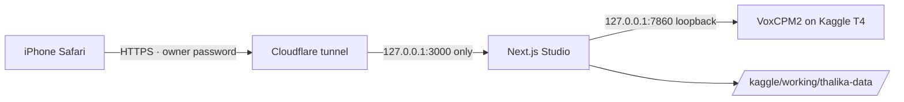

# Kaggle GPU ဖြင့် အသုံးပြုခြင်း (အခမဲ့ T4)

Kaggle notebook ၏ အခမဲ့ GPU ပေါ်တွင် Thalika Studio အပြည့်အစုံကို run ပြီး iPhone Safari မှ HTTPS link
ဖြင့် ဝင်သုံးနိုင်သည်။ မူရင်း VoxCPM2 model၊ Burmese pipeline၊ 48 kHz mono 24-bit WAV output နှင့်
owner login တို့ကို မပြောင်းထားပါ။



## တစ်ကြိမ်တည်း ပြင်ဆင်ရန်

1. [kaggle.com](https://www.kaggle.com) account တွင် **ဖုန်းနံပါတ် verify** လုပ်ပါ။ မလုပ်ထားလျှင်
   GPU နှင့် Internet ကို ဖွင့်မရပါ။
2. Notebook ထည့်ရန် နည်းနှစ်ခုရှိသည် (iPhone ပေါ်တွင် **နည်း ခ** က အလွယ်ဆုံး):
   - **က။ One-tap link:** Kaggle login ဝင်ထားပြီး [Open in Kaggle](https://www.kaggle.com/kernels/welcome?src=https://github.com/phyoethantnaing/thalika-iphone-cloud/blob/cloud-iphone/kaggle/thalika-kaggle.ipynb) ကိုနှိပ်ပါ။
   - **ခ။ Copy-paste:** **Create → New Notebook** ဖွင့်ပြီး ပထမ code cell ထဲက စာကိုဖျက်ကာ
     အောက်ပါ **တစ်ကြောင်းတည်း** ကို paste လုပ်ပါ (file upload မလို):

     ```text
     !rm -rf /tmp/thalika && git clone -q --depth 1 -b cloud-iphone https://github.com/phyoethantnaing/thalika-iphone-cloud /tmp/thalika && python /tmp/thalika/scripts/kaggle-start.py
     ```
3. ညာဘက် **Settings** panel တွင်:
   - **Accelerator → GPU T4 x2** (P100 ကို PyTorch 2.8 မထောက်ပံ့တော့သဖြင့် launcher က ငြင်းပါမည်)
   - **Internet → On**
   - Notebook ကို **Private** ထားပါ (voice reference နှင့် WAV များ output ထဲတွင်သိမ်းသည်)
4. **Add-ons → Secrets** တွင် အောက်ပါတို့ထည့်ပြီး ဒီ notebook အတွက် checkbox ကို on လုပ်ပါ:

| Secret | လိုအပ်ချက် | အကြောင်း |
| --- | --- | --- |
| `THALIKA_OWNER_PASSWORD` | **မဖြစ်မနေ** | Studio login password (စာလုံး ၁၂ လုံးအထက်) |
| `THALIKA_SESSION_SECRET` | optional | စာလုံး ၃၂ လုံးအထက်။ မထည့်လျှင် session တိုင်း ပြန် login ဝင်ရသည် |
| `THALIKA_NOTIFY_URL` | optional | Studio link ကို POST ပို့မည့် `https://` URL (ဥပမာ ntfy.sh topic) |
| `CLOUDFLARE_TUNNEL_TOKEN` + `THALIKA_APP_ORIGIN` | optional | ကိုယ်ပိုင် domain ဖြင့် **မပြောင်းသော URL** လိုလျှင် |
| `GEMINI_API_KEY` | optional | Script rewrite |
| `HF_TOKEN` | optional | Hugging Face download rate limit ရှောင်ရန် |
| `GITHUB_TOKEN` | optional | Repo ကို private ပြောင်းထားလျှင်သာ (read-only token) |

Notebook ထဲမှ `BRANCH` သည် default အားဖြင့် `cloud-iphone` ဖြစ်သည်။ Kaggle support ပါသော
branch ကို merge မလုပ်ရသေးလျှင် ထို branch နာမည်သို့ ပြောင်းပါ။

## နေ့စဉ် အသုံးပြုပုံ

1. Kaggle notebook ကိုဖွင့်ပြီး **Save Version → Save & Run All (Commit)** ကိုနှိပ်ပါ။
   ဤ mode သည် browser/iPhone ပိတ်ထားလည်း background တွင် run နေသည်။
   (စမ်းသပ်ရုံသာဆိုလျှင် cell ကို interactive **Run** လည်းလုပ်နိုင်သည်၊ သို့သော် idle ဖြစ်လျှင် Kaggle ကပိတ်နိုင်သည်။)
2. ပထမအကြိမ်တွင် Node၊ Python 3.11 venv၊ web build နှင့် VoxCPM2 weights download ကြောင့်
   **၁၀–၂၀ မိနစ်ခန့်** ကြာနိုင်သည်။ Kaggle သည် disk ကို session တိုင်းရှင်းသဖြင့် နောက်ကြိမ်တိုင်းလည်း install ပြန်လုပ်ရသည်။
3. Version page → **Logs** ထဲတွင် အောက်ပါအတိုင်းပေါ်လာမည်:

   ```text
   iPhone Safari:  https://xxxx-xxxx.trycloudflare.com
   ```

   ထို link ကို Safari မှာဖွင့်ပြီး `THALIKA_OWNER_PASSWORD` ဖြင့်ဝင်ပါ။ Settings တွင်
   **Loading VoxCPM2 → Warming Up Model → Ready** ဖြစ်မှ generate လုပ်ပါ။
4. Quick-tunnel URL သည် session တိုင်းပြောင်းသည်။ မပြောင်းသော URL လိုလျှင် Cloudflare
   named tunnel token နှင့် `THALIKA_APP_ORIGIN` ကိုထည့်ပါ။
5. Launcher သည် **~၁၁ နာရီ** (notebook ထဲက `MAX_HOURS`) ပြည့်လျှင် generation လုပ်နေတာကို
   ပြီးအောင်စောင့်ပြီး လုံခြုံစွာရပ်ကာ data ကို output အဖြစ်သိမ်းပေးသည်။ အရင်ရပ်ချင်လျှင်
   Kaggle တွင် **Cancel run** နှိပ်နိုင်သော်လည်း cancel လုပ်ထားသော version ၏ output ကို Kaggle က မသိမ်းနိုင်ပါ။
   အရေးကြီး WAV များကို Studio ထဲမှ **Download / Save to Files** ဖြင့် iPhone ထဲသို့အရင်သိမ်းပါ။

## Data နောက်တစ်ကြိမ် ပြန်သုံးရန်

Profiles၊ scripts၊ history နှင့် WAV များကို `/kaggle/working/thalika-data` တွင်သိမ်းပြီး
commit run ပြီးဆုံးလျှင် Kaggle က version output အဖြစ်သိမ်းပေးသည်။

နောက် session မတိုင်မီ notebook editor တွင် **Add Input → Your Work → Notebooks → ဒီ notebook**
ကိုရွေးပါ။ Launcher က attach လုပ်ထားသော output များထဲမှ **နောက်ဆုံးသိမ်းထားသော**
`thalika-data` ကို အလိုအလျောက် restore လုပ်ပေးသည်။ Model cache ကိုသိမ်းမထားပါ (output 20 GB ကန့်သတ်ချက်)။

## ကန့်သတ်ချက်များ

- Kaggle GPU quota သည် ပုံမှန်အားဖြင့် တစ်ပတ်လျှင် ~၃၀ နာရီ၊ session တစ်ခုလျှင် ၁၂ နာရီ ဖြစ်သည်။
  ပမာဏကို Kaggle က ပြောင်းနိုင်သဖြင့် account settings တွင်စစ်ပါ။
- T4 သည် Ampere မတိုင်မီ GPU ဖြစ်သဖြင့် server က **float32** နှင့် `torch.compile` ပိတ်၍ run သည်
  (bfloat16 မရ)။ A100/L4 ကဲ့သို့ GPU များ၏ checkpoint dtype ကို မပြောင်းပါ။ စမ်းလိုလျှင်
  `VOXCPM_DTYPE=float16` / `VOXCPM_OPTIMIZE=1` ဖြင့် override လုပ်နိုင်သော်လည်း အသံ quality ကို ပြန်စစ်ပါ။
- T4 x2 ဖြစ်သော်လည်း model တစ်ခုတည်းကို GPU 0 တွင်သာ run သည် (one worker / one data dir)။
- `trycloudflare.com` quick tunnel သည် Cloudflare ၏ အခမဲ့ testing service ဖြစ်ပြီး uptime အာမခံချက်မရှိပါ။
- Kaggle ၏ စည်းကမ်းများ (acceptable use) ကို ကိုယ်တိုင်ဖတ်ပြီး လိုက်နာပါ။

## ပြဿနာဖြေရှင်းခြင်း

| Log message | ဖြေရှင်းနည်း |
| --- | --- |
| `No GPU` / `not supported by the pinned PyTorch` | Accelerator ကို **GPU T4 x2** သို့ပြောင်းပါ |
| `Add a Kaggle secret THALIKA_OWNER_PASSWORD` | Secret ထည့်ပြီး notebook အတွက် attach checkbox on လုပ်ပါ |
| `Cloudflare tunnel exited` / download error | Settings → **Internet On** ဖြစ်မဖြစ်စစ်ပါ |
| Login တွင် `Invalid request origin` | Log ထဲမှ **နောက်ဆုံး** URL ကိုသာသုံးပါ (tunnel ပြန်စလျှင် URL ပြောင်းသည်) |
| `Model initialization failed` | Log ထဲတွင် Hugging Face download error ကိုကြည့်ပါ၊ `HF_TOKEN` ထည့်ပါ |
